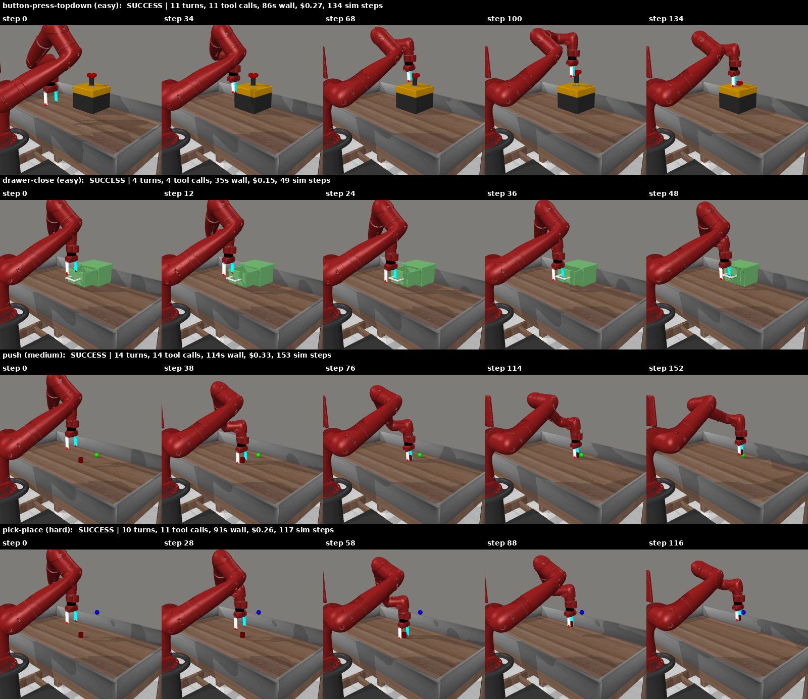
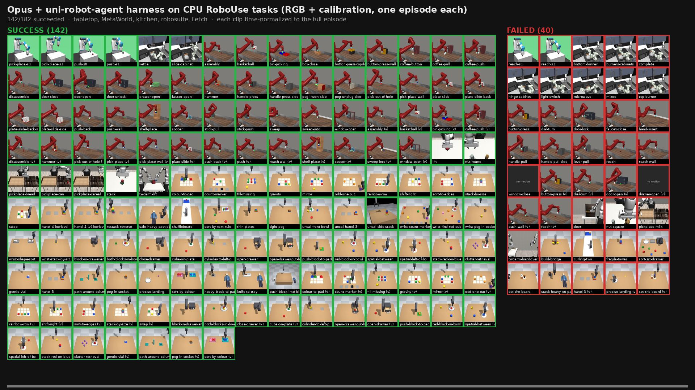

# CPU smoke-test replication of the uni-robot-agent paper

This report covers *Democratizing Robot-Use Agents: A Unified Harness with Open Models* (arXiv 2611.01560). It is a CPU-only sanity check of the harness's mechanisms plus small closed-loop rollouts. **It is not a reproduction of the paper's benchmark numbers.**



Videos:
- [`media/opus_grid.mp4`](media/opus_grid.mp4): native simulator recordings of the four Opus rollouts, played at 10 fps.
- [`media/opus_pick-place_agent_view.mp4`](media/opus_pick-place_agent_view.mp4): the images Opus received after each tool call.
- [`media/haiku_python_push_agent_view.mp4`](media/haiku_python_push_agent_view.mp4): the same view for Haiku with the python tool on `push`.

## Scope and limitations

The headline results were **not** reproduced:
- RoboDojo SR/Score: 31.39 for Qwen3.8-Flash-Next and 28.97 for GPT-6 Astra–RoboProbe, from 42 tasks × 6 episodes.
- The 19-task real-robot evaluation.
- The cost and speed study.

These need Isaac Sim on a GPU, model endpoints and hardware. The environment used here had 4 CPUs, no GPU, no external model API key and no robot.

Two things changed from the paper's setup:
- **Simulator:** RoboUse MetaWorld tasks, rendered with MuJoCo on CPU through OSMesa, stand in for RoboDojo.
- **Planner:** a minimal loop over the SDK's `Session.tools` (scripts below) stands in for the built-in Codex and Claude Code runtimes.

Every rollout cell is **one episode** with seed 0, so the closed-loop results are qualitative.

## 1. Mechanism checks (no simulator, no model)

These tests run the harness's real code against CPU fakes. Scripts: `scripts/e1_motion.py` to `scripts/e4_context.py`.

**E1: monitored motion (App. D, Alg. 1, Eqs. 2–5).** `MotionExecutor` was driven against a kinematic fake arm. With r = 0.1 m and δ = 0.04 m, θ_max = 0.2003 rad and the translation allowance is 0.0200 m, both exactly as Eqs. 2–3 predict. All 8 scenarios end with the expected stop reason:

| scenario | stop reason |
|---|---|
| nominal | `pose_reached` |
| precision profile | `pose_reached` |
| obstacle | `stalled` |
| runaway | `diverging` |
| collision kick | `unsafe_motion` |
| IK reject | `planning_rejected` |
| IK reject + goal-region search | recovered goal, `pose_reached` |
| unreachable | `max_steps` |

**E2: depth-free triangulation (§4.3, §5.1).** `triangulate()` was run with synthetic calibrated cameras and 400 points. Each cell shows the rejection rate and the mean 3-D error of accepted points:

| views | σ=0 px | 1 px | 2 px | 4 px | 8 px |
|---|---|---|---|---|---|
| 2 | 0% / 1.0 mm | 0% / 3.2 mm | 8% / 6.2 mm | 37% / 12.5 mm | 65% / 25 mm |
| 3 | 0% / 0.5 mm | 0.2% / 1.8 mm | 21% / 3.6 mm | 72% / 7.0 mm | 97% / 15 mm |

**E3: pipelining (§2.3, §6.2).** `ParallelToolExecutor` was run with an exclusive arm resource and a scripted agent, with times scaled down about 100×. Serial execution has 0% overlap between model calls and actions. Pipelining gives:
- 88–91% overlap and about 45% shorter episodes when reasoning and execution take similar time.
- 11–12% shorter episodes when either side dominates.
- No gain when every decision depends on the previous result.

The paper reports 84.5–93.8% overlap and 4.8–73.7% shorter episodes.

**E4: image sliding window (§2.5).** `SlidingWindowPolicy` was run for 60 turns with 2 images each. With the default eviction batch of 20, 91.5% of consecutive requests are prefix-stable and the window uses about 5× fewer tokens than no eviction. With a batch of 1, prefix reuse is 0%.

## 2. Closed-loop rollouts on CPU MetaWorld (RGB + calibration, no depth)

Setup:
- **Environment:** RoboUse 0.4.1 MetaWorld through the repository's `scripts/robouse/run_metaworld.sh` profile, with the `corner` and `topview` cameras and `--no-depth`. The official outcome comes from the environment's native result.
- **Planners:**
  - `scripts/mini_agent.py`: OpenAI chat-completions, used here with Qwen3-VL-2B-Instruct Q8 served by a CPU build of llama.cpp.
  - `scripts/claude_agent.py`: one persistent `claude -p --input-format stream-json` process per episode, with built-in tools disabled.
- Both planners use the harness's own assembled robot prompt and tool schemas, and execute every call through `Session.tools`.
- **Python tool** (`--code`): an optional computation-only tool. It preloads numpy, scipy and the move tool's own `rpy_to_quaternion` / `quaternion_to_rpy`. It stands in for the shell that the Codex and Claude Code runtimes provide.

| task (difficulty) | Qwen3-VL-2B | Haiku | Haiku + python | Opus |
|---|---|---|---|---|
| button-press-topdown (easy) | ✗ (2 runs, arm never moved) | ✓ 25 turns, 148 s, $0.020 | – | ✓ 11 turns, 86 s, $0.27 |
| drawer-close (easy) | – | ✗ wrong quaternion→RPY, moves rejected | ✓ 9 turns, 64 s, $0.010 | ✓ 4 turns, 35 s, $0.15 |
| push (medium) | – | ✗ tried to come down on the puck | ✓ 25 turns, 171 s, $0.024 | ✓ 14 turns, 114 s, $0.33 |
| pick-place (hard) | – | ✓ 19 turns, 174 s, $0.020 (success fired mid-transport, possibly fortuitous) | – | ✓ 10 turns, 91 s, $0.26 |

How the observations relate to the paper's claims:
- **Capability ordering:** Qwen-2B (0/1) < Haiku (2/4) < Opus (4/4). This is consistent with §4's finding that robot use tracks general model capability.
- **The §4.3 failure modes appear:**
  - Tool misuse and grounding: Qwen-2B repeated the same invalid `locate` call.
  - Geometric coding: Haiku mixed up quaternion and RPY conventions on `drawer-close`.
  - Embodied reasoning: Haiku tried to come down on top of the puck on `push` instead of pushing it from behind.
- **Code fixes geometric-coding failures (App. E):** with the python tool, Haiku solved both tasks it had failed. On `push`, it back-projected an occluded puck by testing candidate table heights. On both tasks, it computed the exact orientation the move tool requires.
- **Depth isn't needed:** every success localized objects by RGB triangulation from calibrated cameras.
- **Agent completion ≠ environment success:** no Claude run called `finish`. The environment ended each episode at the first success (`success_mode: first`), before the agent could verify it.

## 3. Opus on every CPU-runnable RoboUse task (183 episodes)

This batch ran Opus with the python tool (`--code`) once per admitted task configuration in the five installed simulators:
- **Tasks:** tabletop (86), MetaWorld (70, excluding the 4 above), kitchen (10), robosuite (11) and Fetch (6).
- **Seed:** each task's own default.
- **Limits:** at most 40 turns and 15 minutes per episode.
- **Scripts:** `scripts/batch.py`, `scripts/run_episode_p.sh` and `scripts/run_batch_fg.sh`.
- **Results:** per-episode results are in [`opus_batch/results.csv`](opus_batch/results.csv); the planner summary and native outcome for each episode are in [`opus_batch/episodes.jsonl`](opus_batch/episodes.jsonl).

| group | success | median turns | list-price cost |
|---|---|---|---|
| tabletop/libero-style | 12/12 (100%) | 8 | $3.46 |
| tabletop/arc-style | 11/11 (100%) | 13 | $5.57 |
| tabletop/vision | 28/31 (90%) | 12 | $16.05 |
| tabletop/robo-use-families | 7/8 (88%) | 14.5 | $5.41 |
| tabletop/hard | 16/20 (80%) | 24 | $17.49 |
| tabletop/safety | 3/4 (75%) | 9 | $1.29 |
| MetaWorld (incl. `vision/metaworld-*`) | 52/69 (75%) | 14 | $31.74 |
| Fetch | 4/6 (67%) | 15.5 | $2.68 |
| robosuite | 7/11 (64%) | 23 | $8.06 |
| kitchen | 2/10 (20%) | 40 | $9.76 |
| **total** | **142/182 (78%)** | | **$101.52** |

One episode, `vision/metaworld-sweep-vision`, is excluded because its first planner call stalled twice. The costs are the CLI's list-price estimates; the batch actually ran on a subscription plan's session quota.



[`media/opus_batch_overview.mp4`](media/opus_batch_overview.mp4) plays every episode's native recording at once, time-normalized so each clip runs from start to finish. Successes are bordered green and failures red. `scripts/make_batch_overview.py` regenerates it, along with a 200 px thumbnail video per episode.

Observations:
- **Two calibrated views help.** Success is highest on tabletop, which has two calibrated cameras and so supports triangulation. It is lower on the single-camera simulators (kitchen, robosuite, Fetch), where the agent has to recover depth from a single view.
- **Single-camera failures match the paper.** The failures there look like the paper's spatial-grounding and geometric-coding modes:
  - Fetch `reach` tasks: Opus probed the ray to the floating goal sphere with the gripper and then committed to the wrong depth.
  - Kitchen: Opus usually ran out of turns while computing orientations under the world-Y-roll constraint.
- **Agent completion ≠ environment success.** Opus called `finish` in 101 episodes, and 13 of those were actually failures. In another 54 episodes the environment registered success before Opus called `finish`.
- **The `hard-uncal-*` tasks are not real uncalibrated tests.** The uni-robot-agent RoboUse adapter still supplies MuJoCo render-camera calibration for cameras that the task lists under `uncalibrated_cameras`. The tasks' results therefore don't test the paper's §5.1 "RGB without camera parameters" condition. The adapter should probably honour that field.

Planner-protocol caveats that don't apply to the built-in runtimes, because those use native tool calling:
- **Tool calls in XML form:** Opus sometimes wrote calls in an XML tool-call format instead of the JSON protocol. Once it also wrote an entire imagined episode, with invented feedback.
- **Fixes applied mid-batch:** the parser now accepts the XML form, runs only the first call in a reply, and has a "never write tool results" prompt line. Affected episodes were rerun. Episodes before and after the fix therefore saw slightly different planner prompts.

Infrastructure:
- **Usage limit:** 79 episodes that hit the subscription's 5-hour usage limit were discarded and rerun. The planner now stops on a usage-limit reply instead of spending turns.
- **Restarts:** the batch survived several container restarts by running as a resumable queue, restarted by an hourly check-in.

## Notes for maintainers

- **Possible RoboUse camera issue:** the agent-facing MetaWorld `corner` image is vertically flipped relative to the native recording. The reported calibration matches the flipped image, so triangulation still works. It may still be worth checking the row order in the RoboUse capture path.
- **Excluded run:** one `claude -p` turn stalled for 836 s, which used up an episode's budget. `results/haiku+python_drawer-close_infra-stall/` keeps that run for the record, but it is excluded from the table. `claude_agent.py` now enforces a 180 s per-turn timeout and reports `infra_error`.
- **Cost accounting:** the CLI's `total_cost_usd` is cumulative per session, so costs are the final value. The `cost_total` fields in the `haiku_button-press-topdown` and `opus_button-press-topdown` transcripts were summed before this was fixed. Their `summary.json` files hold the corrected values.
- **Failed scripted baseline:** a fixed RGB-only scripted strategy failed. It triangulated the button correctly, but pressed with a closed gripper and jammed on an edge with about 39 N of force. It is mentioned here as a negative result, and its files are not included.

## Layout

| path | contents |
|---|---|
| `results/<run>/summary.json` | planner summary: turns, tool calls, wall time, cost, `task_success` |
| `results/<run>/native_result.json` | environment's native outcome and metrics (success, progress, steps, contact force) |
| `results/<run>/transcript.jsonl` | per-turn model text and tool calls; image data is not included |
| `results/<run>/agent_log.txt` | condensed console log |
| `media/` | filmstrip and videos |
| `opus_batch/` | per-episode results for the 183-episode Opus batch |
| `scripts/` | experiment scripts |

## Reproducing

```bash
uv venv -p 3.11 .venv && source .venv/bin/activate
uv pip install -e . 'claude-agent-sdk==0.2.165' imageio-ffmpeg
python reports/cpu-smoke-replication/scripts/e1_motion.py   # likewise e2–e4
```

For rollouts, set `WORK` to a scratch directory and create the RoboUse environment as `$WORK/robouse-mujoco`. Use Python 3.12 and `scripts/robouse/requirements-mujoco.txt`, then `uv pip install -e .` into it. Install OSMesa (`libosmesa6`), then run:

```bash
WORK=/path/to/work reports/cpu-smoke-replication/scripts/run_episode.sh metaworld/metaworld-push haiku haiku_push --max-turns 30 --wall-s 600 --code
```

This requires an authenticated `claude` CLI on `PATH`. For the full batch, write the RoboUse inventory to `$WORK/probe/inventory.json` with `scripts/robouse/inventory.py`, then run `WORK=... reports/cpu-smoke-replication/scripts/run_batch_fg.sh`. The batch is resumable and halts on usage limits.
